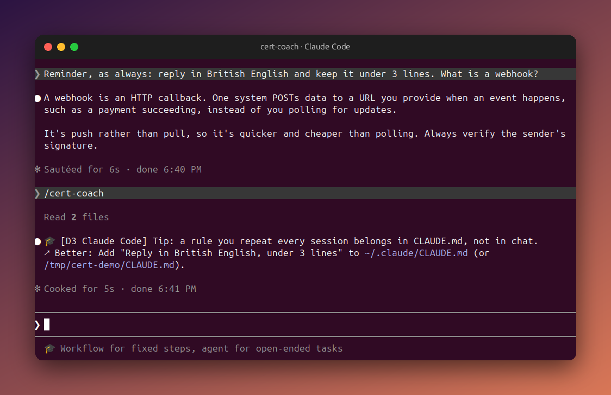
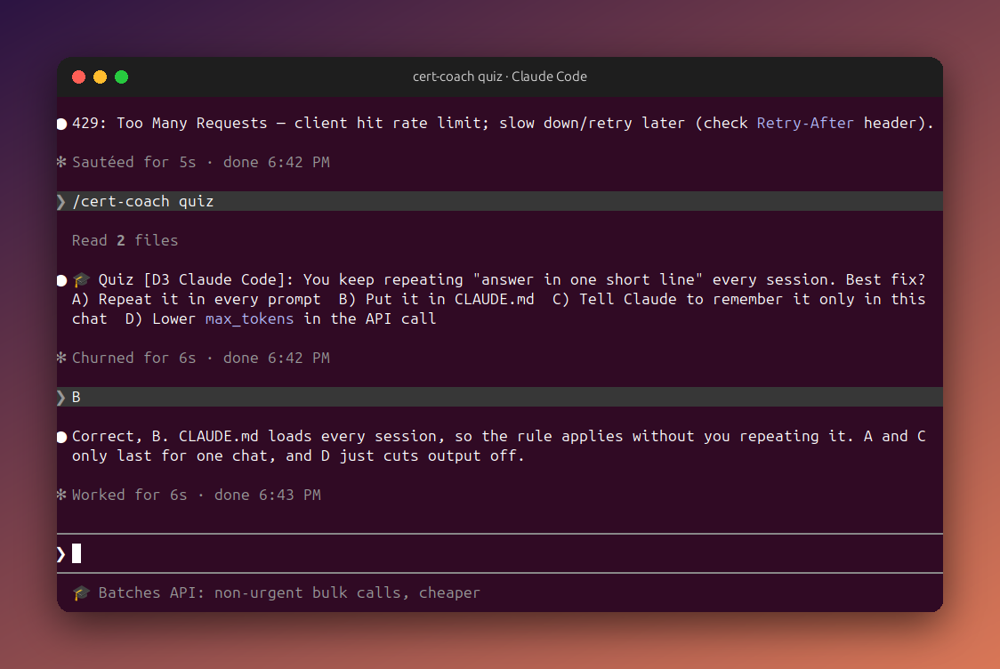

# cert-coach

A small [Claude Code](https://claude.com/claude-code) skill that helps you study for **Anthropic Claude certifications** while you use Claude. It's built to use as few tokens as possible.

<p align="center">
  
</p>

## What it does

| Feature | How it runs | Token cost |
|---|---|---|
| **Statusline tip**: a random exam tip under the prompt | shell script, no model call | **0** |
| **`/cert-coach`**: one exam tip + one "do better" based on your current session | only when you type it, runs on Haiku | very small |
| **`/cert-coach quiz`**: one multiple-choice question in exam style | only when you type it | very small |

### Coaching on what you just did

Use Claude as normal. When you want feedback, type `/cert-coach`. It compares what you just did against a short list of exam-relevant habits and gives you the matching exam domain plus one concrete fix. In the screenshot above, the rule "reply in British English, under 3 lines" was repeated in the prompt, so the coach points to **CLAUDE.md** (Claude Code domain) and says exactly what to add.

The line at the bottom of the screenshot is the zero-cost statusline: a new exam tip each time it refreshes, with no model call.

### Quick quiz

<p align="center">
  
</p>

`/cert-coach quiz` asks one multiple-choice question tied to what you were just doing, and explains the answer once you reply.

> The screenshots are real captures from Claude Code (not mockups) and were taken with the `developer` track.

## Tracks

| Track | Exam | Audience |
|---|---|---|
| `developer` | Claude Certified Developer, Foundations (CCDV-F) | Engineers using the API, Claude Code and MCP |
| `architect` | Claude Certified Architect, Foundations (CCAR-F) | Solution architects designing production systems |
| `associate` | Claude Certified Associate, Foundations (CCAO-F) | Non-coders running Claude workflows |

Architect Professional (CCAR-P) isn't included yet because its domains haven't been confirmed.

> ⚠️ Domain names and weights come from third-party prep sites, not Anthropic's official exam guides. Check them against the official guide before relying on them.

## Install

```bash
git clone https://github.com/abdelazizfacoiti/claude-cert-coach && cd claude-cert-coach
./install.sh               # skill only
./install.sh --statusline  # skill + zero-cost tip statusline (needs jq; replaces any existing statusLine)
```
Then restart Claude Code. The skill is installed at the user level (`~/.claude/skills/`), so it's available in **every** session and project.

## Usage

```
/cert-coach set architect   # switch track (developer | architect | associate)
/cert-coach                 # feedback on the current session
/cert-coach quiz            # one exam-style question
```

## Why it's cheap

- **One skill, one file per cert.** Only the file for your active track is read, and only when you run the skill.
- **`disable-model-invocation: true`**: Claude never triggers it on its own, and its description stays out of your context.
- **`model: haiku`**: a 3-line output doesn't need a bigger model.
- **Hard limits** in `SKILL.md`: at most 2 file reads, no web access, at most 3 lines of output.
- The statusline is a plain bash script (`shuf` on a text file), so it costs no tokens.

## Layout

```
cert-coach/
  SKILL.md          # skill instructions (~20 lines)
  certs/<track>.md  # domains + weights + "pattern -> domain -> better practice" signals
  tips/<track>.txt  # one tip per line, used by the statusline
  statusline.sh     # prints a random tip for the active track
  config            # active track (gitignored, created by install.sh)
install.sh
docs/               # README screenshots
```

## Add a certification

1. `cert-coach/certs/<name>.md`: domain list with weights, then `- pattern -> domain -> better` lines.
2. `cert-coach/tips/<name>.txt`: short tips, one per line.
3. Add `<name>` to the track list in `SKILL.md` and in this README.

## Sources (third-party, verify)

- [Training Camp: all four Claude exams](https://trainingcamp.com/articles/claude-certifications-explained-all-four-anthropic-exams-costs-and-who-can-take-them/)
- [dnacenta/claude-certified-architect](https://github.com/dnacenta/claude-certified-architect)
- [CCDV-F domains](https://claudearchitectcertification.com/certifications/ccdv-f)
